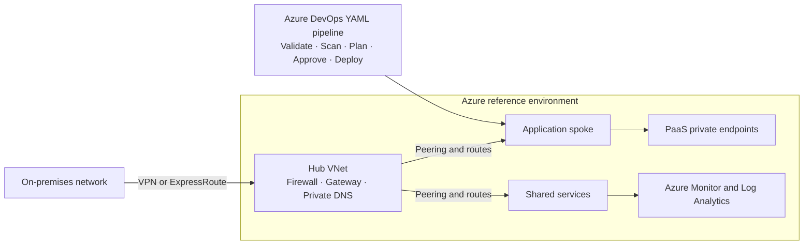

<h1 align="center">Hi, I'm Komal 👋</h1>

  

  
  
  

## ☁️ About Me

I’m an aspiring **Azure DevOps Engineer** building hands-on skills in Azure cloud infrastructure, Terraform, and Azure DevOps CI/CD. I enjoy turning infrastructure and delivery steps into repeatable, secure workflows—and sharing what I learn through practical projects.

## 🧰 Technical Skills

- **Azure Cloud:** Virtual Machines, VNets, subnets, NSGs, Storage, Load Balancer, Key Vault
- **DevOps & CI/CD:** Azure DevOps YAML pipelines, Azure Repos, Git, GitHub, branching, pull requests
- **Infrastructure as Code:** Terraform, modules, variables, outputs, Azure Blob remote state
- **DevSecOps:** tfsec, Checkov, infrastructure validation, security scans, approval workflows
- **Identity & security:** Microsoft Entra ID, RBAC, Managed Identity, least privilege
- **Monitoring & operations:** Azure Monitor, Log Analytics, Linux, PowerShell, Bash
- **Cloud practices:** Landing Zones, networking, governance, backup and disaster recovery, FinOps

## 🚀 Projects

### [Hospital Management – Azure DevOps](https://github.com/komal324mane/hospital-management-azure-devops)
Explore the project repository for its implementation, tools, and current status.

### Terraform Infrastructure & Azure DevOps Pipelines · In Progress
Hands-on work with Terraform infrastructure automation and YAML CI/CD pipelines for Azure.

## 🔄 DevOps Workflow

  <strong>Code</strong> → <strong>Git</strong> → <strong>Pull Request</strong> → <strong>Validation</strong> → <strong>Security Scan</strong> → <strong>Terraform Plan</strong> → <strong>Approval</strong> → <strong>Deployment</strong> → <strong>Monitoring</strong>

## 🧪 Learning Projects & Hands-on Labs

- **Azure foundations:** Practice provisioning VMs, virtual networks, subnets, NSGs, Storage, Load Balancers, and Key Vault.
- **Terraform on Azure:** Build reusable modules and practice variables, outputs, and remote state with Azure Blob Storage.
- **DevSecOps pipelines:** Explore YAML validation, tfsec and Checkov scans, Terraform plan review, and gated deployments.
- **Architecture reference designs:** Learn Azure Landing Zones, hub-and-spoke networking, identity and governance, backup and disaster recovery, and FinOps.

## 🏗️ Azure Architecture & DevSecOps Reference

This is a **learning/reference architecture**, not a claim of a production deployment.

## 🛠️ Tools

## 🤝 Connect

I’m always learning and building—feel free to explore my work or connect with me here:

