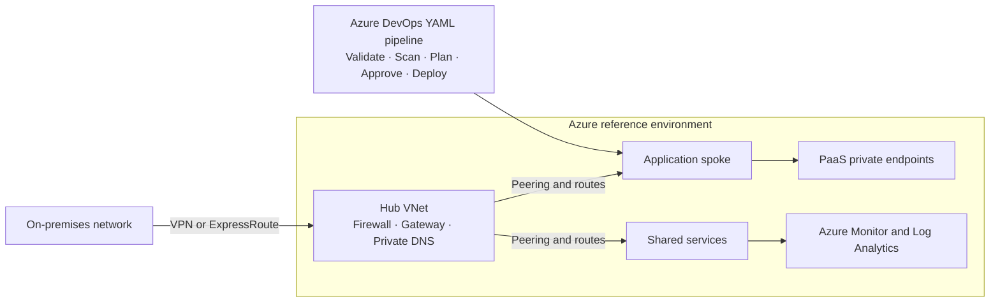

# Hi, I'm Komal 👋

### Azure DevOps Engineer

I’m building hands-on experience with Azure cloud infrastructure, Terraform, and Azure DevOps CI/CD. My focus is on repeatable Infrastructure as Code, secure delivery workflows, cloud governance, and reliable operations.

## Technical Skills

- **Cloud:** Microsoft Azure, Virtual Machines, VNets, subnets, NSGs, Storage, Load Balancer, Key Vault
- **DevOps & CI/CD:** Azure DevOps, YAML pipelines, Azure Repos, GitHub, branching strategies, pull requests
- **Infrastructure as Code:** Terraform, modules, variables, outputs, Azure Blob remote state
- **DevSecOps:** tfsec, Checkov, infrastructure validation, security scanning, approval workflows
- **Identity & security:** Microsoft Entra ID, RBAC, Managed Identity, least-privilege access
- **Monitoring & operations:** Azure Monitor, Log Analytics, Linux, PowerShell, Bash
- **Cloud practices:** Landing Zones, networking, governance, backup and disaster recovery, FinOps

## Projects

- **[Hospital Management – Azure DevOps](https://github.com/komal324mane/hospital-management-azure-devops):** Portfolio project; visit the repository for implementation details and current status.
- **Terraform infrastructure automation & Azure DevOps pipelines — In progress:** Hands-on work with reusable Terraform and YAML CI/CD workflows for Azure infrastructure.

## DevOps Workflow

`Code` → `Git` → `Pull Request` → `Validation` → `Security Scan` → `Terraform Plan` → `Approval` → `Deployment` → `Monitoring`

## Learning Projects & Hands-on Labs

- **Azure Cloud foundations:** Practice provisioning VMs, virtual networks, subnets, NSGs, Storage, Load Balancers, and Key Vault.
- **Terraform on Azure:** Build and organize modules, configure variables and outputs, and practice remote state with Azure Blob Storage.
- **DevSecOps pipelines:** Explore YAML validation, tfsec and Checkov scanning, plan review, and gated deployment workflows.
- **Architecture reference designs:** Explore Azure Landing Zones, hub-and-spoke networking, identity and governance, backup and disaster recovery, and FinOps.

## Azure Architecture & DevSecOps Reference

The diagram below is a learning/reference architecture, not a claim of a production deployment.

## Tools

## Contact

- **GitHub:** [github.com/komal324mane](https://github.com/komal324mane)
